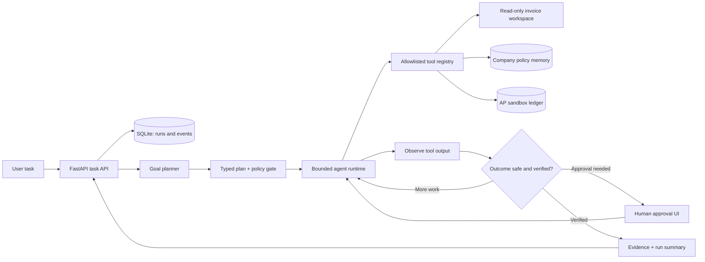

# Architecture and runtime contract

## The scope

The proof of concept performs one meaningful business workflow: find a vendor invoice in a local sandbox, extract its typed fields, validate it against company policy, create an accounts-payable record in SQLite, and read that record back to verify completion. The source invoices are real local JSON files; the ledger mutations, approval decisions, run state, and audit events are real persistent database writes.

## System view

## Goal → Understand → Plan → Execute → Observe → Adapt → Verify → Complete

1. **Goal / understand.** The API persists a run before starting work. The planner checks whether the request is in the supported workflow and identifies a vendor from the company-approved list. With `OPENAI_API_KEY` configured it may use an OpenAI-compatible chat-completions endpoint for this extraction; without a key, local matching handles the sample tasks.
2. **Plan.** The accepted plan is typed JSON. The allowed actions and action order are bounded to `search_invoices → extract_invoice → validate_invoice → create_payable → verify_payable`. The model cannot add a tool or execute code.
3. **Execute.** The runtime selects the next action from the persisted observations and invokes only the fixed tool registry. Each action has explicit input preconditions.
4. **Observe / adapt.** Actual tool results update per-run state. No-match and ambiguous cases stop for user input; incomplete extraction or policy failures block writes; transient tool errors are retried with a bounded attempt count; approval pauses the write branch.
5. **Verify.** The agent reads the ledger record back and compares source ID, vendor, amount, due date, and status. “Completed” is only emitted when all checks pass.
6. **Evidence.** The API returns the selected source, extracted fields, decisions, tool attempts, approval decision, and verification comparison as an event timeline.

## Trust boundaries and safety invariants

- **No arbitrary execution.** No shell, arbitrary URL, browser session, or user-provided function tool exists. Unknown tool names are rejected.
- **Allowlisted suppliers.** Vendors are checked against persistent company policy before a write.
- **Approval before mutation.** A payable at or above ₹50,000 pauses before the INSERT. A browser approval is a persistent decision, not a model-generated claim.
- **Idempotent write boundary.** `payables.source_invoice_id` is unique; a repeated task does not create a second record.
- **Bounded runtime.** Tool attempts are limited to three and the task loop has an eight-step budget. Human approval expires after ten minutes in this local worker.
- **Read-after-write verification.** The system cannot report success based only on the create tool's response.
- **Local sandbox only.** All sample suppliers/invoices and the ledger are synthetic. No real company credentials are stored or used.

## Data model

- `runs`: goal, status, timestamps, validated plan, serializable working state, current approval request/decision, final summary, and error.
- `run_events`: append-only style audit records for planning, actions, results, retries, policy decisions, approval, and completion.
- `company_memory`: persisted policy snapshot loaded by the tool layer on each run.
- `payables`: unique source invoice, vendor, amount, due date, status, creation timestamp, and originating run ID.
- `backend/data/invoices/*.json`: read-only demo input documents.

## API surface

| Method | Endpoint | Purpose |
|---|---|---|
| GET | `/api/health` | Runtime status, planner mode, policy thresholds |
| GET | `/api/memory` | Active company policy and guardrails |
| GET | `/api/invoices` | Sample source invoices |
| GET | `/api/ledger` | Current AP sandbox records |
| GET | `/api/runs` | Recent persistent runs |
| GET | `/api/runs/{id}` | Full run state and audit events |
| POST | `/api/runs` | Queue a natural-language task |
| POST | `/api/runs/{id}/approval` | Persist approval or rejection and resume the workflow |

Interactive API docs are available at `/docs`.

## Key design decisions

### Why one narrow workflow?
A narrow system is a stronger autonomy proof than a UI that pretends to control arbitrary apps. Invoice intake has visible source data, meaningful company policy, a real mutation boundary, an approval point, and a deterministic verification oracle. The tool/runtime boundary can later be reused for browser, file, and internal-system connectors.

### Why deterministic tool execution when an LLM planner is available?
The LLM is useful for interpreting intent but is not trusted to enforce permissions, decide that a write is safe, or self-certify completion. The runtime owns action preconditions, approval thresholds, retry budgets, idempotency, and read-after-write verification. This is a deliberate separation of probabilistic planning from deterministic execution controls.

### Why SQLite and an in-process worker?
The deadline prototype must run with one command and no external services. SQLite demonstrates persistent state, unique constraints, auditability, and recovery without infrastructure setup. The in-process async worker is a prototype choice, not the intended multi-tenant production queue.

### What changes for production?
Use a durable queue/workflow engine (e.g. Temporal, or a broker-backed worker), tenant-scoped Postgres with migrations, managed secrets, OAuth connector grants, encrypted artifact storage, role-based approvals, rate limits, per-tenant budgets, structured tracing/metrics, sandboxed browser workers, data retention controls, and an automated evaluation suite. Keep the tool contracts, policy gate, idempotency keys, and verification contract stable while replacing adapters.
